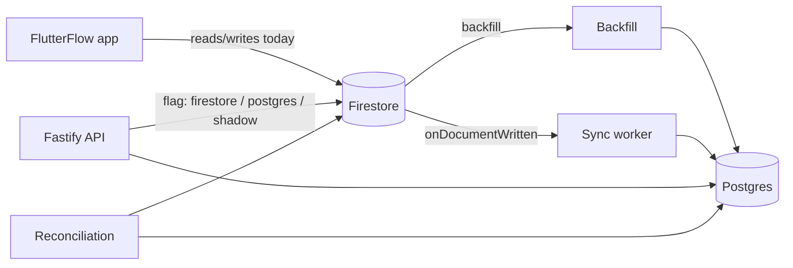

# Driving-school migration: Firestore → Postgres, with no downtime

A small, runnable proof of how to move a FlutterFlow + Firestore product to Node.js (TypeScript, Fastify) + PostgreSQL **without switching the app off and without losing data**. The domain is a driving school: cities, pickup points, instructors, students and lesson bookings.

## The problem

The app's data lives in Firestore, which enforces no schema. Years of app versions left it messy:
- dates stored as text in three formats
- the same person signed up twice
- bookings pointing at students who no longer exist
- an instructor booked for two lessons at the same time

The goal is to move to Postgres, where bad states are impossible by construction. The app keeps working throughout, and every step can be undone.

## The approach

1. **Make bad states impossible in the database.** An exclusion constraint guarantees no instructor or student ever has two overlapping active lessons, even when two requests race ([ADR 0002](docs/adr/0002-exclusion-constraint.md)).
2. **Copy everything, safely and repeatably.**
   - The backfill is batched, resumable after a crash, and idempotent: a second run changes nothing.
   - Bad records go to a rejects table with a reason instead of crashing the run.
3. **Prove the copy is right.** Reconciliation compares counts, a checksum per record and monthly totals. It exits non-zero on any difference: that is the cutover gate.
4. **Keep it in sync while both stores live.** A listener applies every Firestore change. The newer version always wins, so duplicate or out-of-order events are harmless ([ADR 0003](docs/adr/0003-idempotent-upserts.md)).
5. **Switch screens over one at a time.** An API reads from Firestore, Postgres, or both (shadow mode, which compares the two). A single setting flips a screen, and flipping it back is the rollback.

The full plan is in [docs/migration-strategy.md](docs/migration-strategy.md), covering phases, old FlutterFlow versions, the team split and GDPR. The rule behind every bad-data case is in [docs/data-quality-decisions.md](docs/data-quality-decisions.md).

## Architecture



Locally, the Firestore emulator stands in for Firestore and `onSnapshot` stands in for the production triggers. Every path above (backfill, sync, reconciliation and the API's Firestore reads) uses **the same normalisers**, so the stores are always compared on the same terms.

## Prerequisites

- **Node.js 22.9+** and **pnpm 12** (`corepack enable` picks the pinned version)
- **Docker** with Compose, for Postgres 16. The Docker host may be another machine (a remote Docker context); then point `DATABASE_URL` at that host.
- **Java 21+**, for the Firestore emulator. `firebase-tools` refuses older versions. The `firebase` CLI comes with `pnpm install`; no global install is needed.

## Quickstart

```bash
cp .env.example .env      # use a long random password if your Postgres port is reachable from the network
pnpm install
pnpm db:up && pnpm db:migrate
pnpm emulator             # in its own terminal; UI at http://127.0.0.1:4000
pnpm seed                 # messy, deterministic data into the emulator
pnpm backfill
pnpm reconcile
```

`pnpm demo` runs the whole flow from scratch: database, migrations, emulator, seed, two backfills, reconciliation, the API and a 409. See [scripts/demo.sh](scripts/demo.sh).

## Demo script

Run these in order; each shows what you should see. Numbers are from a real run.

**1. Seed the emulator.** `pnpm seed` writes 3 cities, 12 pickup points, 19 instructors, 316 students and 2,193 bookings. In the Emulator UI (http://127.0.0.1:4000/firestore):
- `bookings/bk_date_it_string` stores its start as the text `"21/10/2026 14:30"`
- `bk_overlap_a` and `bk_overlap_b` book the same instructor 30 minutes apart
- `students/st_dup_rossi_a` and `st_dup_rossi_b` are the same person

**2. Backfill.** `pnpm backfill`
```
entity        read  inserted  updated  unchanged  rejected  warnings  events
cities        3     3         0        0          0         0         0
pickupPoints  12    12        0        0          0         0         0
instructors   19    19        0        0          0         0         0
students      316   306       0        0          0         13        0
bookings      2193  2185      0        0          8         12        5619
```
- 8 rejects, one per reason: `ORPHAN_STUDENT`, `ORPHAN_INSTRUCTOR`, `OVERLAP_INSTRUCTOR`, `OVERLAP_STUDENT`, `INVALID_DATE`, `DST_GAP`, `INVALID_STATUS`, `INVALID_DURATION`.
- 316 student docs become 306 students, because 10 second sign-ups were merged.
- It takes about 3 seconds, even with Postgres on another machine over Wi-Fi.

**3. Backfill again.** `pnpm backfill` shows `inserted 0`, `updated 0`, every row `unchanged`: the backfill is idempotent.

**4. Read the rejects.** The run report (`reports/run-<id>.md`) lists legacy ids only:
```
| booking | bk_overlap_b       | OVERLAP_INSTRUCTOR | overlaps bk_overlap_a (same instructor) |
| booking | bk_student_overlap | OVERLAP_STUDENT    | overlaps bk_student_base (same student) |
| booking | bk_status_unknown  | INVALID_STATUS     | status "rescheduled" has no mapping; needs a product decision |
```
The database made the double booking impossible. Ops resolves it from this list.

**5. Reconcile.** `pnpm reconcile` checks every count and checksum and ends with `RESULT: clean (exit 0)`. Then break one row and run it again:
```bash
echo "update bookings set price_cents = price_cents + 1 where legacy_id = 'bk_00042';" | docker compose exec -T db psql -U driving -d driving_school
pnpm reconcile   # → "bookings bk_00042: differs in priceCents", RESULT: NOT clean (exit 1)
```
It names the record and the field, never the values. Undo it with `- 1`.

**6. Live sync.** Run `pnpm sync`, then edit a booking in the Emulator UI. It appears in Postgres within a second; we measured 885 ms with Postgres on another machine.

**7. The API.** `pnpm dev`, then:
```bash
curl -H 'x-read-source: shadow' http://127.0.0.1:3000/v1/bookings/bk_00042   # serves Firestore, compares with Postgres
curl http://127.0.0.1:3000/debug/shadow-stats                                 # {"compared":1,"matched":1,...}
curl -X POST http://127.0.0.1:3000/v1/bookings -H 'content-type: application/json' \
  -d '{"studentId":"st_fx_09","instructorId":"in_fx_01","startsAt":"2026-09-15T10:30:00+02:00","durationMin":60}'
# → 409 {"code":"BOOKING_OVERLAP",...}
```

**8. The plan.** Close with [docs/migration-strategy.md](docs/migration-strategy.md): the phases, old FlutterFlow versions, the team split, and the rollback at each step.

## Commands

| Command | What it does |
|---|---|
| `pnpm db:up` / `db:down` | Start or stop Postgres 16 (docker compose) |
| `pnpm db:migrate` | Apply `db/migrations/*.sql` in order. Refuses if an applied file was edited. |
| `pnpm db:reset` | Drop everything and migrate from zero (only `driving_school*` and `ds_test_*` databases) |
| `pnpm emulator` | Firestore emulator, project `demo-driving-school`, UI on :4000 |
| `pnpm seed [--target=emulator\|json\|firestore]` | Deterministic messy data. `json` rewrites `test/fixtures/export.json`. |
| `pnpm backfill [--source=emulator\|firestore\|json] [--dry-run] [--resume] [--only=bookings] [--batch-size=500]` | Copy Firestore into Postgres |
| `pnpm reconcile [--source=…]` | Compare both stores; exit 1 unless clean |
| `pnpm sync [--source=emulator\|firestore]` | Listen to Firestore and apply every change |
| `pnpm dev` | The API on http://127.0.0.1:3000 |
| `pnpm test` / `test:unit` / `test:int` | Vitest; integration tests need `TEST_DATABASE_URL` |
| `pnpm typecheck` / `lint` / `format` | TypeScript, Biome |
| `pnpm demo` | Everything above, end to end |

## Design decisions

- **Postgres, with the rules in the schema:** foreign keys, CHECKs and an exclusion constraint. → [ADR 0001](docs/adr/0001-postgres.md)
- **No double booking, guaranteed by the database, not the app.** Half-open time ranges `[)` let back-to-back lessons touch, and only `booked`/`confirmed`, non-deleted lessons count. → [ADR 0002](docs/adr/0002-exclusion-constraint.md)
- **Newer wins, everywhere.** The backfill and sync share one upsert rule, which makes re-runs, duplicates and out-of-order events harmless. → [ADR 0003](docs/adr/0003-idempotent-upserts.md)
- **Pure normalisers** turn each messy document into either a clean row with warnings, or a reject with one reason code. They do no I/O, so every rule has a table-driven test.
- **Legacy ids at the edge.** The app knows Firestore ids, so the API speaks them, and `legacy_id_map` translates. Merged duplicates resolve to the surviving student.
- **Split-and-retry writes.** Each batch is one statement. When a row breaks a constraint, the batch is halved until that row is found. A clean batch costs one round trip, and "first in wins" is kept exactly.
- **No ORM.** Kysely gives typed queries; raw SQL is used where SQL *is* the feature: upserts, savepoints and the constraint itself.

## Repository map

```
db/migrations/        plain SQL, append-only (the runner refuses edited files)
src/normalize/        pure rules: dates, status, phone, money, email, one per entity, student merge
src/migrate/          backfill, upserts, rejects/warnings, reconciliation, live sync, reports
src/source/           readers (Firestore, JSON export), listener, document store
src/api/              Fastify app, routes, Postgres/Firestore/shadow readers, error mapping
src/seed/             deterministic generator + the §3.2 known-bad fixtures
src/cli/              one entry point per pnpm command
test/unit/            no I/O; every normaliser and every fixture
test/integration/     real Postgres, one throwaway database per test file
docs/                 strategy, data-quality decisions, ADRs
```

## Tests

- **Unit tests** cover every normaliser and every §3.2 fixture through the real export path, and assert that clean generated data produces zero warnings.
- **Integration tests** run against the Postgres at `TEST_DATABASE_URL`: the compose database locally, a service container in CI. A global setup migrates a template database once; each test file copies it, so files never see each other's data.
- **Must-haves covered:** idempotency, resume after a crash (at two different points), the exclusion constraint, reconciliation catching a mutation, sync newer-wins, and the API's 409.
- **CI** (GitHub Actions) runs typecheck, lint, `db:migrate` and all tests on every push. The JSON export replaces the emulator there.

## Security and GDPR

- **No credentials in the repo.** `.env` and `*service-account*.json` are gitignored.
- **Logs hide personal data,** in both camelCase and snake_case: emails, phones, tax codes, names and notes, plus the authorization header and the database's error details.
- **Reports and diffs name legacy ids and fields only,** never values.
- **`migration_rejects.payload` holds raw documents, which is personal data.** Restrict access to it, and purge it after cutover.

More in [docs/migration-strategy.md](docs/migration-strategy.md#gdpr).

## Production notes

This is a portfolio proof, not production code. Where production would differ:
- **Sync:** Cloud Functions v2 `onDocumentWritten` → Pub/Sub → a Cloud Run worker calling `syncDocument`, with a dead-letter topic and a nightly reconciliation.
- **Backfill at scale:** COPY into a staging table and find overlaps with one set-based query.
- **Student dedupe:** a staging table with `row_number()`, not in memory.
- **Postgres:** in an EU region, for example Cloud SQL in `europe-west8` (Milan).
